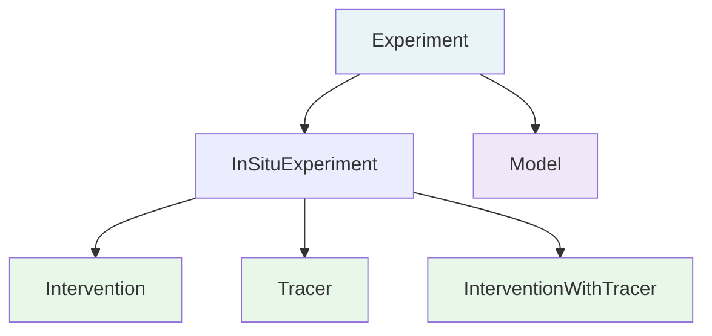

# Projects & Experiments

## Projects

A **[Project](https://schema.oaedata.org/Project.md)** is an OAE field trial, modeling effort or research initiative: who is
doing the work, where and when. A metadata file has exactly one project, and every experiment and
dataset in it carries that project's `project_id`.

## Experiments

An **[Experiment](https://schema.oaedata.org/Experiment.md)** is one activity within a project, such as a baseline monitoring
phase followed by an intervention. Each dataset names the experiment it came from with `experiment_id`.

### What Counts as One Experiment

An experiment is a campaign the project treats as one unit: a named trial, deployment, crediting
period, cruise or model study. Use the project's own names and boundaries.

- Keep a named campaign as one experiment even if the feedstock lot, dose rate or schedule changed
  during it. Describe the phases in its fields.
- Campaigns with different names, or separated in time with their own reporting, are separate
  experiments.
- A model that is configured in some detail (code, grid, forcing) is a Model experiment, even before
  the dates of a specific run are known.
- Laboratory studies, permit applications and monitoring programmes are not experiments.

### Experiment Types

| Type | Schema Class | When to Use |
|------|-------------|------------|
| **Baseline** | [InSituExperiment](https://schema.oaedata.org/InSituExperiment.md) | Pre-intervention monitoring |
| **Control** | [InSituExperiment](https://schema.oaedata.org/InSituExperiment.md) | Reference measurements without intervention |
| **Intervention** | [Intervention](https://schema.oaedata.org/Intervention.md) | Active alkalinity addition |
| **Tracer Study** | [Tracer](https://schema.oaedata.org/Tracer.md) | Dye or gas tracer deployment |
| **Intervention + Tracer** | [InterventionWithTracer](https://schema.oaedata.org/InterventionWithTracer.md) | Combined intervention with tracer (same dosing mechanism) |
| **Model** | [Model](https://schema.oaedata.org/Model.md) | Computational simulation |
| **Other** | [InSituExperiment](https://schema.oaedata.org/InSituExperiment.md) | Experiment type not covered above |

!!! note "When to use Intervention + Tracer"
    Only use the combined type when the alkalinity dosing and tracer dosing share the same underlying dosing mechanism or regimen. If they use separate delivery systems or schedules, create two separate experiments — one Intervention and one Tracer Study.

### Combining Types

`experiment_types` can hold several values, and the combination decides which class describes the
experiment:

- **Intervention** and **Tracer Study** together use
  [InterventionWithTracer](https://schema.oaedata.org/InterventionWithTracer.md), which has the fields of both. See the note
  above on when to combine them.
- **Model** experiments use [Model](https://schema.oaedata.org/Model.md), which has none of the in-situ fields. Describe field
  work and modeling as separate experiments.
- **Baseline**, **Control** and **Other** on their own use [InSituExperiment](https://schema.oaedata.org/InSituExperiment.md).
